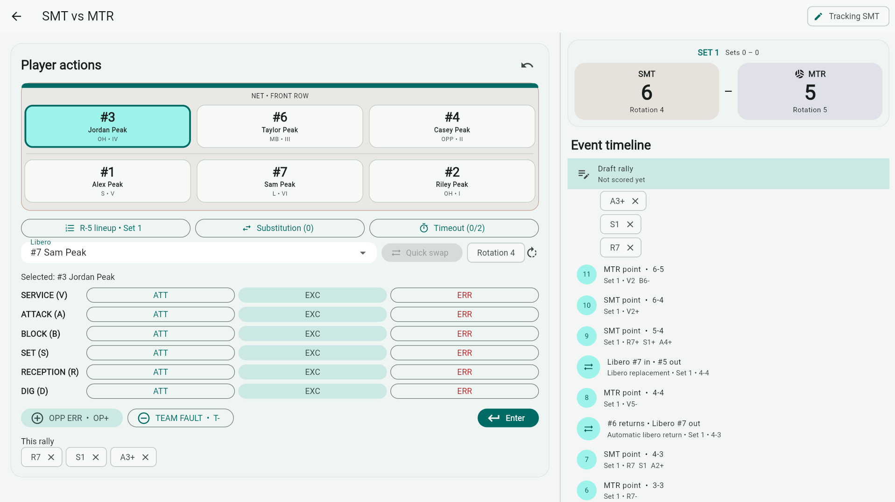
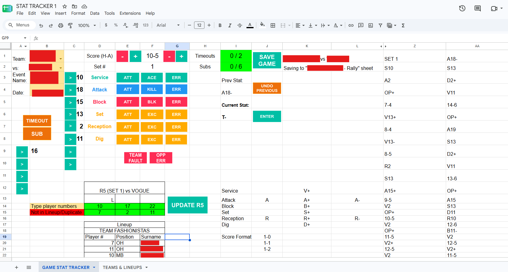

# VC SETS

VC SETS (Statistics & Event Tracking System) helps the UPLB Volleyball Club run tournaments and record volleyball matches. Organizers set up teams and fixtures, while two scorers track the same match on separate devices. Afterward, they compare the rally logs, resolve differences, and finalize one record for standings and player statistics.

The app is built with Flutter for Windows, Android, and the web. Match data is stored on each device, so scoring does not depend on a live connection between the scorers.

## Screenshots



## What it does

- Set up tournaments, teams, rosters, and match rules. Generate round-robin fixtures, pool play followed by a knockout bracket, or a knockout-only bracket. Optional third-place matches are supported.
- Score rallies on two devices. Each scorer records rally winners and player actions for an assigned team.
- Import the other scorer's log, compare rallies and scores, resolve discrepancies, and finalize the match.
- View standings and player totals from finalized matches. Export standings, player statistics, and R-5/substitution records as CSV, or generate a printable report.
- Export a full backup of tournament data and restore it later.

## Run the app

The repository includes Windows and Android Flutter targets and a web app with an installable PWA manifest. A GitHub Pages workflow builds and deploys the web version when configured for the repository.

**Web app:** [VC SETS](https://nicodecastro.github.io/vc-sets/). Open it once while connected; your browser's install option may then be available, depending on the browser and device.

To run from source, install Flutter and use these commands from `app/`:

```powershell
flutter pub get
flutter run -d windows
```

For the web version, run `flutter run -d chrome`. For Android, connect a device or start an emulator, check its ID with `flutter devices`, then run `flutter run -d <device-id>`.

## Match-day workflow

1. On the tournament device, create the tournament, teams, rosters, and fixture.
2. Export the fixture as a `.vcgame` package and import it on the second device.
3. Assign one team to each scorer and select the same first server on both devices.
4. Both scorers award each rally. Each records player actions for their assigned team.
5. Export the second scorer's completed `.vcgame` package and import it on the tournament device.
6. Compare the logs, resolve highlighted differences, and finalize the official match. Export a backup after match day.

## Architecture and design decisions



The first stat tracker iteration ran on Google Sheets and Google Apps Script directly integrated with the spreadsheets that computes for top performers and individual awards. However, this approach required a stable internet connection during matches. VC SETS was built to be offline-first. Each device keeps its data locally and initial syncing is performed using custom backup files. Reconciliation for games is performed manually on a device by exporting the `.vcgame` files. Integration with the existing sheets was done by allowing exporting the player statistics as CSV which can then be copied and pasted for the computation of top performers and individual awards.

- **Offline-first architecture:** VC SETS stores data on each device so scorers can record a match without a live connection. The web build includes its SQLite WebAssembly file and Drift worker locally.
- **Cross-platform use:** Flutter provides one application for different devices through an installable PWA. Drift uses a native SQLite file on Windows and Android and SQLite through WebAssembly in the browser.
- **Independent scoring and reconciliation:** Two scorers keep separate rally logs and record actions for their assigned teams. An organizer imports both logs, resolves missing rallies or conflicting scores and winners, and finalizes an official record. The app validates the result against the match rules and retains both scorer logs.
- **Portable file exchange:** Scorers transfer .vcgame files between devices instead of syncing through a server. Packages and backups use versioned JSON with a SHA-256 integrity hash. The app tracks imported package IDs to prevent duplicate imports.
- **CSV export for existing award calculations:** The player statistics export follows the format needed by the existing Google Sheets report, which contains the formulas for top performers and individual awards. Keeping those calculations in the sheet reduced the risk of reimplementing them under a short deadline and lets other tournaments use their own award rules.
- **Reports derived from finalized matches:** Standings and player totals are calculated from official match records, avoiding a second set of editable totals.
- **Responsive layout for tournament devices:** The interface was designed around the laptops, iPads, and tablets intended for the app’s first live deployment. Wider screens use a navigation rail and more space for match details; narrower screens use bottom navigation and compact layouts.

## Development

From `app/`:

```powershell
flutter pub get
flutter test
flutter run -d windows
flutter run -d chrome
```

## Data and backups

Tournament and match data stays in the device's local database until someone exports it. The GitHub Pages deployment serves the app files; it does not store match data. `.vcgame` packages and full backups are plain JSON and may contain player names and other roster information. Store and share exported files accordingly.
